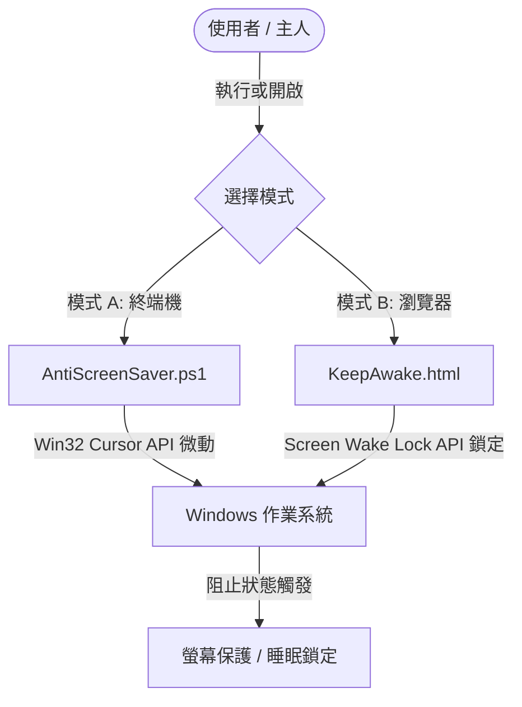
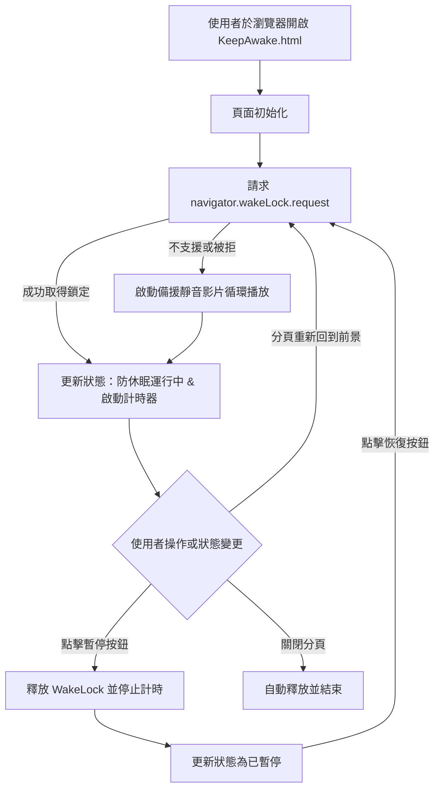
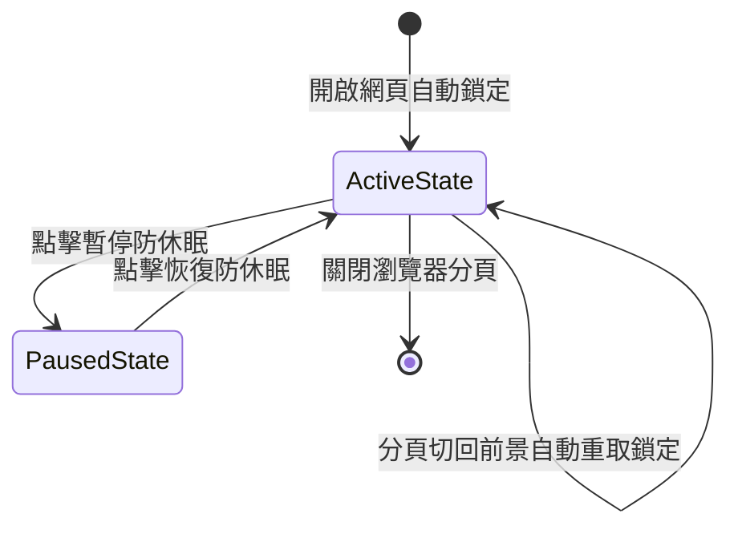
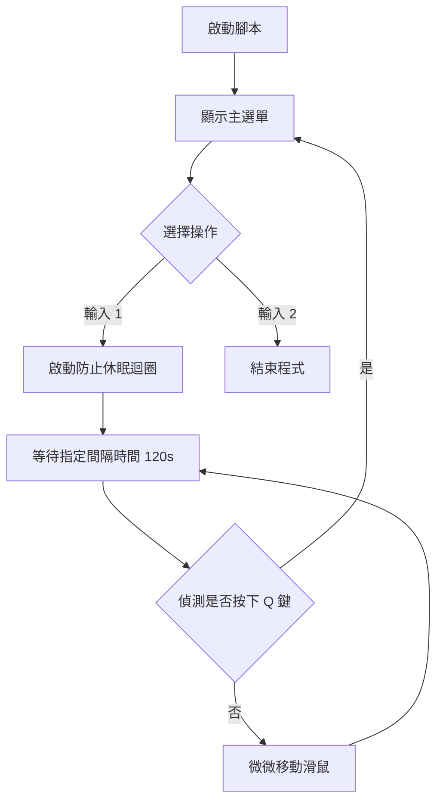

# AntiScreenSaver 規格文件

## 1. 架構與選型
本專案提供雙軌架構，滿足一般個人環境與企業受限環境：

1. **PowerShell 腳本版 (`AntiScreenSaver.ps1`)**
   - **作業系統**: Windows
   - **語言**: PowerShell 7+ (`pwsh`)
   - **依賴**: 內建 .NET API `System.Windows.Forms.Cursor`
   - **適用場景**: 允許執行本機 PowerShell 腳本的環境。

2. **免安裝網頁喚醒版 (`KeepAwake.html`)**
   - **平臺**: 現代瀏覽器 (Microsoft Edge, Google Chrome 等)
   - **技術**: HTML5, CSS3, JavaScript (W3C Screen Wake Lock API)
   - **備援機制**: 內嵌 HTML5 Video 靜音微循環
   - **適用場景**: 企業資安環境有端點防護 (EDR)、防毒軟體封鎖 `.ps1`、阻擋可疑捷徑或限制 ExecutionPolicy 時的零阻礙替代方案。

## 2. 系統脈絡圖 (System Context)


## 3. 關鍵流程 (Key Workflow)

### 3.1 網頁版 KeepAwake.html 流程圖


### 3.2 網頁版狀態圖 (State Diagram)


### 3.3 PowerShell 版關鍵流程


## 4. 虛擬碼 (Pseudocode)

### KeepAwake.html
```javascript
// 核心喚醒鎖定邏輯
async function acquireWakeLock() {
    if ('wakeLock' in navigator) {
        wakeLock = await navigator.wakeLock.request('screen');
        wakeLock.addEventListener('release', onReleased);
        updateUI(true);
    } else {
        // Fallback: 靜音循環播放微型影音
        fallbackVideo.play();
        updateUI(true);
    }
}

async function releaseWakeLock() {
    if (wakeLock) await wakeLock.release();
    fallbackVideo.pause();
    updateUI(false);
}
```
