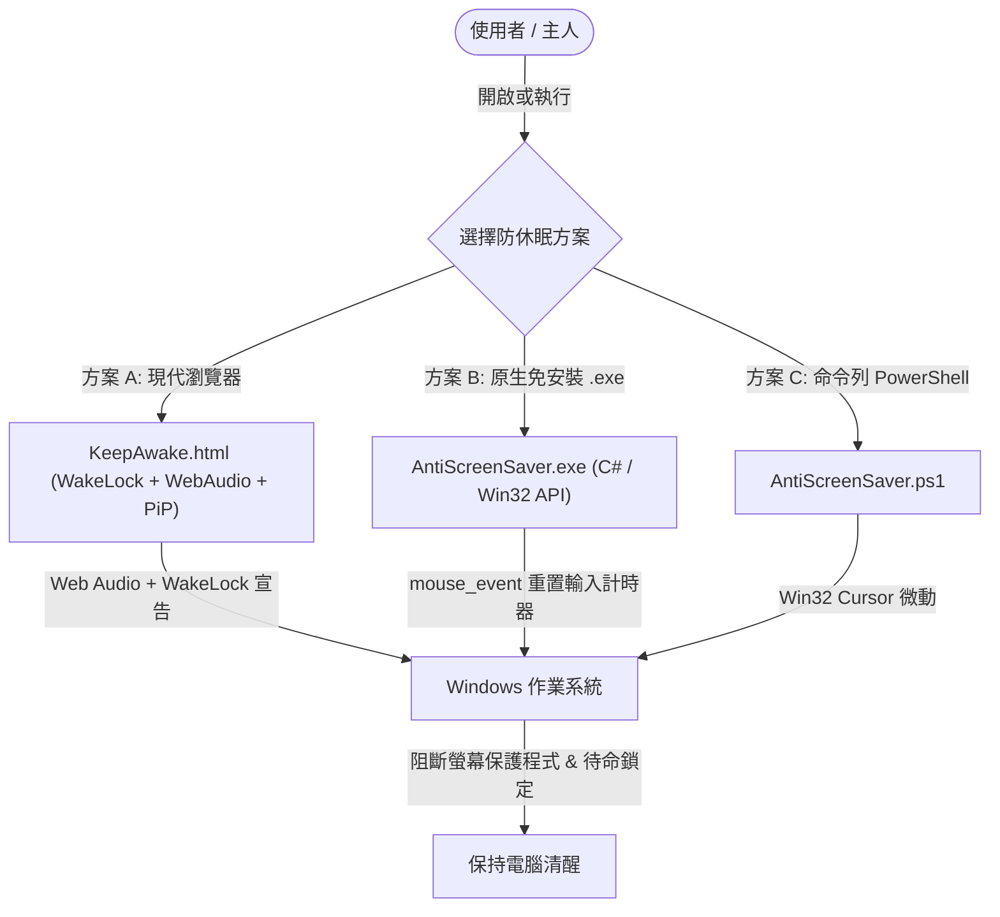
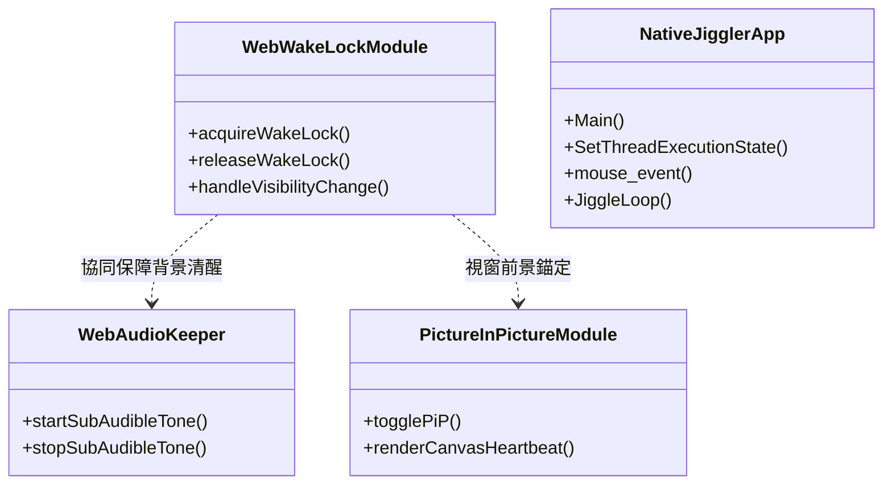
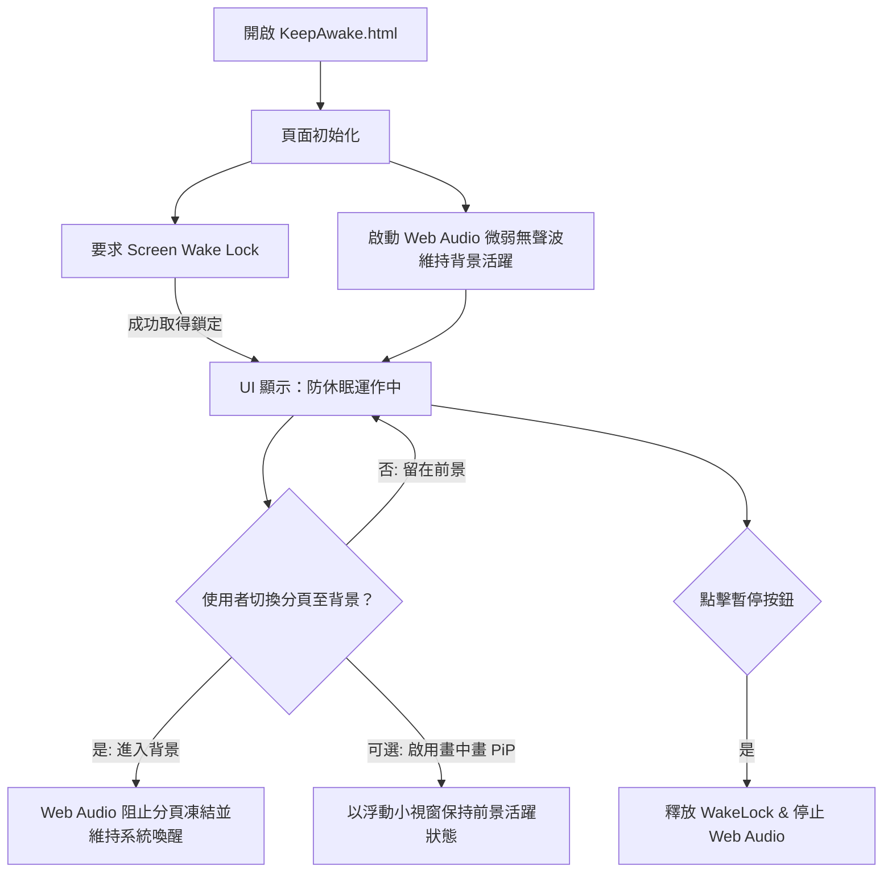
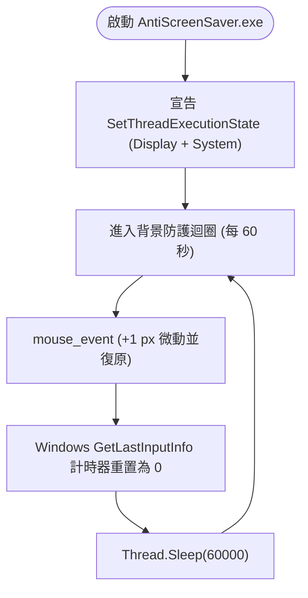
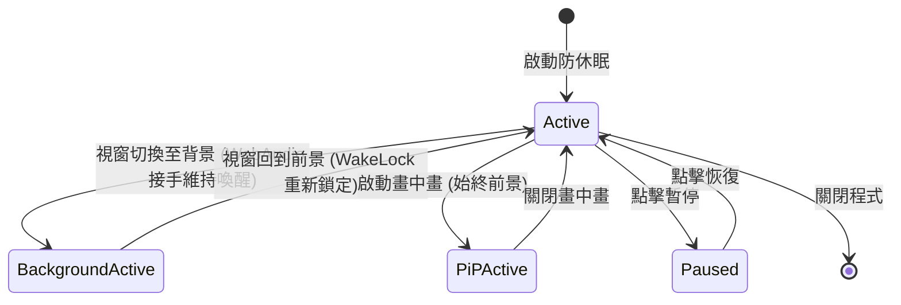

# AntiScreenSaver 規格文件 (spec.md)

## 1. 架構與選型
本專案提供多軌架構，徹底解決一般環境與企業 GPO 嚴格受限環境下的休眠問題：

1. **強化版免安裝網頁喚醒版 (`KeepAwake.html`)**
   - **平臺**: 現代瀏覽器 (Microsoft Edge, Google Chrome, Firefox 等)
   - **多重防護機制**:
     - **主鎖定**: W3C Screen Wake Lock API（前景顯示器鎖定）
     - **背景不凍結 (Audible Audio)**: Web Audio API 微弱次音頻產生器（20Hz / 振幅 0.0005），模擬持續音訊播放，防止背景分頁被瀏覽器休眠，並向作業系統宣告媒體運作。
     - **畫中畫（Picture-in-Picture, PiP）機制**: 利用 `<canvas>` 動態串流彈出 PiP 小視窗，強制分頁維持實質前景活躍狀態，徹底消除 WakeLock 在背景被瀏覽器自動釋放的問題。
     - **離線音訊循環備援**: 內建有效之無聲循環音軌 Data URI。

2. **原生 C# 免安裝雙保險版 (`AntiScreenSaver.cs` / `AntiScreenSaver.exe`)**
   - **作業系統**: Windows 10 / 11
   - **編譯器**: Windows 內建 .NET Framework 編譯器 (`csc.exe`)，無須安裝額外 SDK
   - **Win32 API 調用**:
     - `mouse_event`: 每 60 秒微幅移動滑鼠游標 (±1 px)，重置 Windows `GetLastInputInfo` 輸入閒置計時器，完全破解企業 AD GPO 螢幕保護程式鎖定。
     - `SetThreadExecutionState`: 宣告 `ES_CONTINUOUS | ES_DISPLAY_REQUIRED | ES_SYSTEM_REQUIRED`，保證系統與顯示器雙重清醒。
   - **優勢**: 單一可執行檔，完全免除 PowerShell 執行權限（ExecutionPolicy）與 EDR 針對 `.ps1` 腳本的攔截。

3. **PowerShell 腳本版 (`AntiScreenSaver.ps1`)**
   - **語言**: PowerShell 7+ (`pwsh`)
   - **適用場景**: 開發者本機終端機日常使用。

---

## 2. 系統脈絡圖 (System Context)


---

## 3. 模組關係圖


---

## 4. 關鍵流程圖 (Key Workflow)

### 4.1 網頁版 KeepAwake.html 強化流程圖


### 4.2 C# 原生免安裝執行檔流程圖


---

## 5. 狀態轉換圖 (State Diagram)


---

## 6. 虛擬碼 (Pseudocode)

### Web Audio 微弱無聲波維持背景活躍
```javascript
function startSubAudibleTone() {
    const audioCtx = new (window.AudioContext || window.webkitAudioContext)();
    const osc = audioCtx.createOscillator();
    const gain = audioCtx.createGain();
    
    // 設定為 20Hz (人耳聽覺極限邊緣) 且音量微小 (0.0001)，達到實質無聲
    osc.frequency.value = 20;
    gain.gain.value = 0.0001;
    
    osc.connect(gain);
    gain.connect(audioCtx.destination);
    osc.start();
    return { audioCtx, osc };
}
```

### C# 原生 Win32 滑鼠微動與電源喚醒
```csharp
[DllImport("user32.dll")]
static extern void mouse_event(uint dwFlags, uint dx, uint dy, uint dwData, UIntPtr dwExtraInfo);

[DllImport("kernel32.dll")]
static extern uint SetThreadExecutionState(uint esFlags);

const uint ES_CONTINUOUS = 0x80000000;
const uint ES_SYSTEM_REQUIRED = 0x00000001;
const uint ES_DISPLAY_REQUIRED = 0x00000002;

SetThreadExecutionState(ES_CONTINUOUS | ES_SYSTEM_REQUIRED | ES_DISPLAY_REQUIRED);
while (keepRunning) {
    mouse_event(0x0001, 1, 0, 0, UIntPtr.Zero);  // +1 px
    mouse_event(0x0001, 0xFFFFFFFF, 0, 0, UIntPtr.Zero); // -1 px
    Thread.Sleep(60000);
}
```
